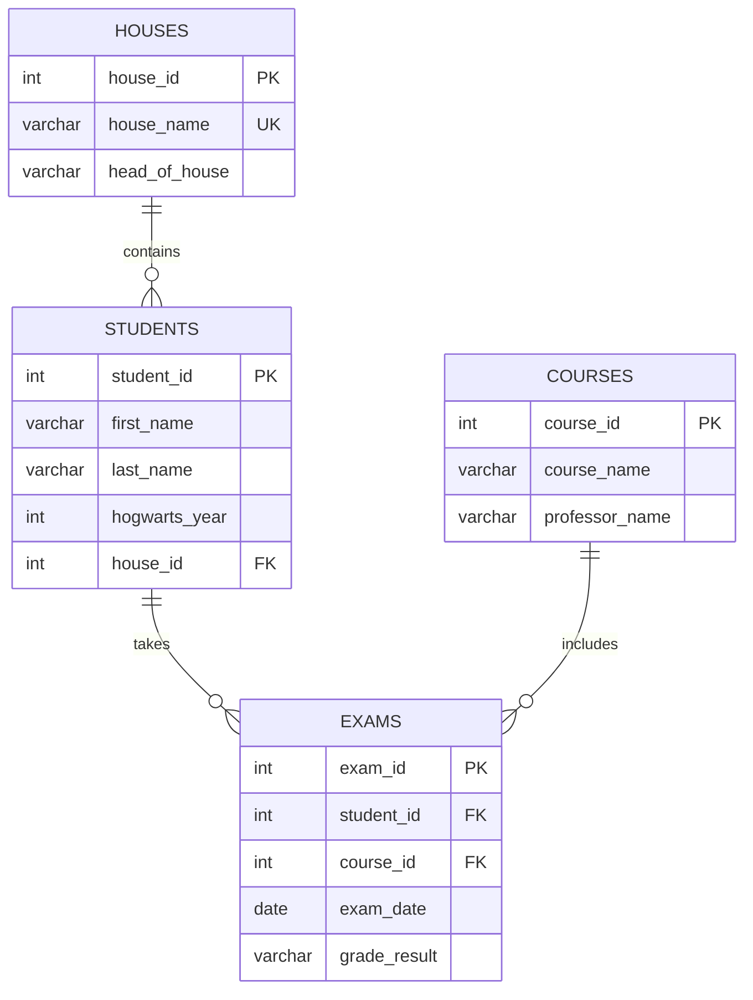

# Hogwarts SQL Sandbox: Architecture

## 1. Project Overview

Hogwarts SQL Sandbox is a PostgreSQL-based SQL practice environment built around a fictional Hogwarts academic database.

The repository contains 30 SQL challenges, reference solutions, a Python-based test runner, and focused PostgreSQL concept guides.

The challenges progress from basic filtering and joins to advanced SQL techniques, including:

- Aggregations and conditional expressions
- Subqueries and Common Table Expressions (CTEs)
- Window functions and window framing
- JSONB and PostgreSQL arrays
- Relational division and conditional aggregation
- ROLLUP and statistical analysis
- Time-series gap analysis
- UPSERT operations
- Recursive CTEs
- Materialized views
- EXPLAIN ANALYZE and query performance analysis

The project is intended for local learning, experimentation, and validation of SQL solutions.

### Technology Stack

| Component | Technology |
|---|---|
| Database | PostgreSQL 15 |
| Database image | `postgres:15-alpine` |
| Containerization | Docker Compose |
| Programming language | Python |
| Database driver | psycopg2-binary |
| Test framework | pytest |
| Additional dependency | tabulate |

---

## 2. Repository Structure

```text
hogwarts-sql-sandbox/
│
├── docs/
│   ├── architecture.md
│   └── concepts/
│       ├── hierarchical_rollups_and_statistical_volatility.md
│       ├── moving_averages_window_framing.md
│       ├── nested_jsonb_architectural_guide.md
│       ├── postgresql_native_arrays_array_operations.md
│       ├── postgresql_upserts_mutation_mechanics.md
│       ├── query_explain_analyze.md
│       ├── recursive_ctes_state_tracking.md
│       └── time_series_gap_analysis.md
│
├── init/
│   ├── 01_schema.sql
│   └── 02_seed.sql
│
├── solutions/
│   └── 04_solutions.sql
│
├── workspace/
│   └── 03_challenges.sql
│
├── test_runner.py
├── docker-compose.yml
├── requirements.txt
├── .gitignore
└── README.md
```

### Directory Responsibilities

| Component | Responsibility |
|---|---|
| `init/` | Defines the PostgreSQL schema and inserts the sample dataset. |
| `workspace/` | Contains the 30 challenge prompts and serves as the workspace for user solutions. |
| `solutions/` | Contains the reference SQL implementations used for validation. |
| `test_runner.py` | Extracts SQL question blocks, executes queries, and validates their results. |
| `docs/concepts/` | Contains focused explanations of selected PostgreSQL concepts. |
| `docker-compose.yml` | Configures the PostgreSQL development container and host port mapping. |
| `requirements.txt` | Lists the Python packages required by the test runner. |

---

## 3. Database Architecture

The sandbox uses a relational PostgreSQL database named `hogwarts`.

It contains four tables:

### 3.1 Houses

Stores the Hogwarts houses and their respective heads.

| Column | Description |
|---|---|
| `house_id` | Primary key |
| `house_name` | Unique house name |
| `head_of_house` | Name of the house head |

### 3.2 Students

Stores student information and house membership.

| Column | Description |
|---|---|
| `student_id` | Primary key |
| `first_name` | Student's first name |
| `last_name` | Student's last name |
| `hogwarts_year` | Current Hogwarts year (1–7) |
| `house_id` | Foreign key referencing `houses.house_id` |

### 3.3 Courses

Stores course information and the professors teaching them.

| Column | Description |
|---|---|
| `course_id` | Primary key |
| `course_name` | Course name |
| `professor_name` | Professor's name |

### 3.4 Exams

Stores student examination attempts, dates, courses, and grades.

| Column | Description |
|---|---|
| `exam_id` | Primary key |
| `student_id` | Foreign key referencing `students.student_id` |
| `course_id` | Foreign key referencing `courses.course_id` |
| `exam_date` | Examination date |
| `grade_result` | Grade received by the student |

### 3.5 Entity Relationships



### 3.6 Database Constraints

The schema enforces the following constraints:

- Primary keys uniquely identify records in each table.
- `houses.house_name` must be unique.
- `students.house_id` references `houses.house_id`.
- `exams.student_id` references `students.student_id`.
- `exams.course_id` references `courses.course_id`.
- Deleting a student or course cascades to the associated examination records.
- The combination of `student_id`, `course_id`, and `exam_date` must be unique.
- `grade_result` accepts only the following values: `o++`, `o+`, `o`, `ee`, `a`, `p`, and `troll`.
- `hogwarts_year` must be between 1 and 7.

The database schema is defined in `init/01_schema.sql`, and the sample records are inserted through `init/02_seed.sql`.

---

## 4. Database Initialization and Docker Configuration

The PostgreSQL environment is managed through Docker Compose.

### 4.1 Container Configuration

The current configuration uses:

| Setting | Value |
|---|---|
| Compose service | `postgres-sandbox` |
| Docker image | `postgres:15-alpine` |
| Database | `hogwarts` |
| Username | `wizard` |
| Password | `password` |
| Container port | `5432` |
| Host port | `5433` |
| Host address | `localhost` |

The port mapping is:

```yaml
ports:
  - "5433:5432"
```

This maps port `5433` on the host machine to PostgreSQL's default port `5432` inside the container.

The non-default host port avoids conflicts when another PostgreSQL instance is already using port `5432`.

### 4.2 Initialization Scripts

The `init/` directory is mounted into the PostgreSQL container at:

```text
/docker-entrypoint-initdb.d/
```

During the first initialization of an empty PostgreSQL data directory, the official PostgreSQL Docker image executes the initialization scripts in alphabetical order:

1. `01_schema.sql` — creates the database tables and constraints.
2. `02_seed.sql` — inserts the sample Hogwarts records.

**Important:** These scripts are not executed again when an already-initialized container or database volume is restarted.

Changing an initialization SQL file does not automatically update an existing database. A fresh initialization is required for the scripts to run again.

### 4.3 Starting the Database

From the repository root:

```bash
docker compose up -d
```

Check the container status:

```bash
docker compose ps
```

Check PostgreSQL readiness:

```bash
docker compose exec postgres-sandbox pg_isready -U wizard -d hogwarts
```

Connect to PostgreSQL using the container's `psql` client:

```bash
docker compose exec postgres-sandbox psql -U wizard -d hogwarts
```

The Python test runner connects through the host port `5433`, not the container port `5432`.

---

## 5. Challenge Organization

The repository contains 30 SQL challenges arranged by increasing complexity.

| Range | Level | Main Concepts |
|---|---|---|
| Q1–Q6 | Basic | Filtering, sorting, joins, and counting |
| Q7–Q13 | Intermediate | Aggregation, conditional logic, subqueries, and GPA calculations |
| Q14–Q20 | Advanced | Window functions, pivoting, JSONB, relational division, and conditional aggregation |
| Q21–Q28 | Expert | ROLLUP, statistical analysis, arrays, time-series analysis, UPSERTs, and recursive CTEs |
| Q29–Q30 | PostgreSQL Mastery | Materialized views, telemetry metrics, and execution-plan analysis |

The progression is designed to develop practical SQL skills, starting with relational data retrieval and gradually introducing analytical queries and PostgreSQL-specific capabilities.

---

## 6. Test Runner Architecture

The project uses `test_runner.py`, implemented with Python, psycopg2, and pytest.

The test runner reads two SQL files:

- `workspace/03_challenges.sql` — user-submitted SQL answers.
- `solutions/04_solutions.sql` — reference implementations.

### 6.1 Question Extraction

Each question is identified using a comment marker:

```sql
-- QUESTION 1: Description of the challenge
```

The runner extracts the SQL associated with each question marker.

It also handles the legacy exploratory Q11, Q24, and Q25 markers that appear before the canonical Q1–Q30 section in the reference solutions file.

### 6.2 Marker Integrity

The test suite checks that both SQL files contain the required question markers for Q1–Q30.

This helps identify missing or duplicated question markers before query validation.

### 6.3 Query Comparison: Q1–Q28

For Q1–Q28, the runner:

1. Extracts the user's SQL query.
2. Extracts the corresponding reference query.
3. Executes both queries using isolated database savepoints.
4. Compares the returned column names.
5. Compares the result rows.

Row ordering is ignored during comparison, but duplicate rows are preserved and considered.

### 6.4 Materialized View Validation: Q29

Q29 receives dedicated validation because it involves a materialized view.

The runner:

1. Executes the user's materialized-view definition.
2. Executes the reference materialized-view definition.
3. Checks the expected output columns.
4. Independently calculates the daily metrics.
5. Compares the actual materialized-view contents against the independent calculation.

The expected columns are:

- `exam_date`
- `total_exams`
- `failed_exams`
- `failure_rate_percent`

### 6.5 Execution Plan Validation: Q30

Q30 validates two alternative query approaches using `EXPLAIN ANALYZE`.

The runner checks:

- Both approaches contain exactly two `EXPLAIN ANALYZE` statements.
- Both approaches execute successfully.
- Both approaches return equivalent results.
- User results match the reference results.
- Results match an independent GPA calculation.

It also displays execution-plan metrics, including:

- Planning time
- Execution time
- Estimated total cost
- Root actual execution time

The test does not require one approach to be faster. Execution performance depends on factors such as database size, indexes, caching, query planning, PostgreSQL version, and hardware.

### 6.6 Transaction Isolation

The runner uses database transactions and savepoints to isolate query execution and roll back changes.

This prevents query modifications made during validation from permanently affecting the underlying sample dataset.

---

## 7. PostgreSQL Concept Guides

The `docs/concepts/` directory provides additional explanations for selected advanced challenges.

| Guide | Related Challenge | Main Topic |
|---|---|---|
| `hierarchical_rollups_and_statistical_volatility.md` | Q21–Q22 | ROLLUP and standard deviation |
| `moving_averages_window_framing.md` | Q25 | Moving averages and window frames |
| `nested_jsonb_architectural_guide.md` | Q17 | Nested JSONB aggregation |
| `postgresql_native_arrays_array_operations.md` | Q23 | ARRAY_AGG and array operations |
| `postgresql_upserts_mutation_mechanics.md` | Q27 | ON CONFLICT, EXCLUDED, and RETURNING |
| `query_explain_analyze.md` | Q30 | Execution plans and query optimization |
| `recursive_ctes_state_tracking.md` | Q28 | Recursive CTEs and sequential state tracking |
| `time_series_gap_analysis.md` | Q24 | generate_series and missing-date analysis |

These guides provide additional context for understanding the PostgreSQL features used in the exercises.

---

## 8. Local Development Workflow

### 8.1 Prerequisites

- Git
- Docker Desktop or Docker Engine with Docker Compose
- Python 3.10 or newer
- A terminal with access to the repository

### 8.2 Start PostgreSQL

From the project root:

```bash
docker compose up -d
```

Wait until PostgreSQL is ready:

```bash
docker compose exec postgres-sandbox pg_isready -U wizard -d hogwarts
```

### 8.3 Create a Python Virtual Environment

**Windows PowerShell:**

```powershell
python -m venv .venv
.venv\Scripts\Activate.ps1
```

**Linux, macOS, or WSL:**

```bash
python3 -m venv .venv
source .venv/bin/activate
```

### 8.4 Install Dependencies

```bash
python -m pip install -r requirements.txt
```

The dependencies are:

- `psycopg2-binary`
- `pytest`
- `tabulate`

### 8.5 Work on Challenges

1. Open `workspace/03_challenges.sql`.
2. Find the question you want to solve.
3. Write your SQL answer below its corresponding question marker.
4. Keep the question marker format intact.
5. Run the test runner to validate your answer.

Example:

```sql
-- QUESTION 1: List all students enrolled in Gryffindor.

SELECT
    first_name,
    last_name
FROM students
WHERE house_id = 1;
```

Keep your answers in the workspace file and use the reference solutions only for comparison and learning.

### 8.6 Run the Complete Test Suite

```bash
python test_runner.py
```

Alternatively:

```bash
python -m pytest -v test_runner.py
```

### 8.7 Run a Specific Question

The test runner supports exact question selection:

```bash
python test_runner.py --question 1
```

Other examples:

```bash
python test_runner.py --question 25
python test_runner.py --question 29
python test_runner.py --question 30
```

Q30 automatically enables additional output for its execution-plan comparison.

---

## 9. Database Configuration

The Python test runner uses the following default connection settings:

```python
DB_CONFIG = {
    "dbname": "hogwarts",
    "user": "wizard",
    "password": "password",
    "host": "localhost",
    "port": 5433,
}
```

The connection settings can be overridden through environment variables:

| Variable | Default |
|---|---|
| `DB_NAME` | `hogwarts` |
| `DB_USER` | `wizard` |
| `DB_PASSWORD` | `password` |
| `DB_HOST` | `localhost` |
| `DB_PORT` | `5433` |

For example, in Linux or macOS:

```bash
export DB_HOST=localhost
export DB_PORT=5433
python test_runner.py
```

In Windows PowerShell:

```powershell
$env:DB_HOST = "localhost"
$env:DB_PORT = "5433"
python test_runner.py
```

These settings allow the test runner to connect to a different local PostgreSQL instance when required.

---

## 10. Stopping and Resetting the Database

### Stop the Container

```bash
docker compose stop
```

This stops PostgreSQL without deleting the database data.

### Start the Existing Container

```bash
docker compose start
```

### Remove Containers

```bash
docker compose down
```

This removes the Compose containers and network but does not remove named volumes.

### Reset the Database Completely

To recreate the database from the initialization scripts:

```bash
docker compose down -v
docker compose up -d
```

**Warning:** The `-v` option deletes the PostgreSQL data volume. Any data stored in that volume will be permanently removed.

Use this command only when you intentionally want to discard the existing database and initialize a fresh copy.

---

## 11. Design Principles

The project follows these principles:

- **Practice before abstraction:** Each challenge focuses on a specific SQL problem or PostgreSQL feature.
- **Reference-based validation:** Query outputs are compared against reference implementations wherever applicable.
- **Isolated execution:** Transactions and savepoints help prevent test queries from affecting one another.
- **Concept-driven learning:** Advanced topics have dedicated documentation.
- **Progressive complexity:** Challenges move from foundational SQL to advanced analytical and database-engineering concepts.
- **Practical experimentation:** The environment allows users to execute, modify, and validate SQL queries locally.

---

## 12. Project Scope and Limitations

Hogwarts SQL Sandbox is a local SQL learning and experimentation project, not a production application.

- The sample database credentials are intended for local development only.
- PostgreSQL is exposed on host port `5433`.
- The Python test runner expects the database to be accessible using the configured connection settings.
- Initialization scripts execute automatically only when PostgreSQL initializes an empty data directory.
- The workspace must contain SQL answers before the corresponding query tests can pass.
- Query execution-plan metrics are environment-dependent and should not be treated as universal performance benchmarks.

The repository is designed to be forked, cloned, and used as an independent PostgreSQL practice environment.

---

**Project scope:** This is a local SQL learning and experimentation sandbox, not a production application. The sample credentials and database configuration are intended for local development only.